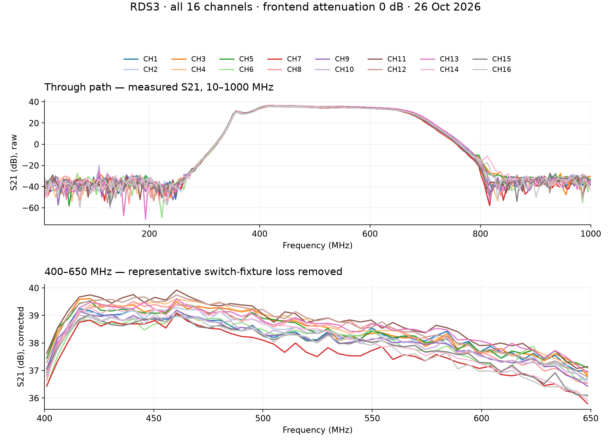
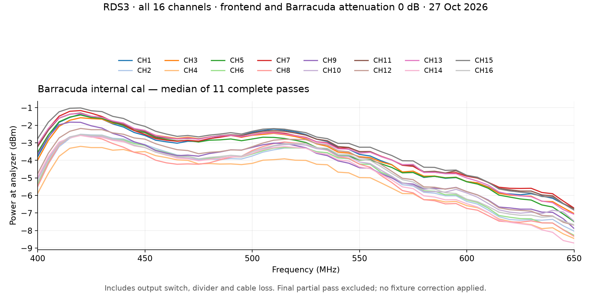

# RDS3 measured test data

Measurements of **RDS3-62EB988A0FDC**, with all 16 frontends at **0 dB attenuation**.
These are measurements of this unit and setup, with no pass/fail limits applied.

## Through path: antenna input to receiver output



Recorded October 26, 2026, in through mode, with calibration banks off. ATP jobs
139 (CH1–8) and 140 (CH9–16), firmware `3.0.0-rc1`. The Keysight P9375B VNA
recorded 201 points from 10 to 1000 MHz at −35 dBm source power and 100 kHz IF
bandwidth, with its correction disabled.

The upper plot shows raw S21, including the switch fixture and cables. The lower
plot shows 400–650 MHz with a representative joined-switch S21 trace subtracted
in dB. This removes an estimate of fixture loss, using the October 27 fixture
measurement; it is not a separate calibration for each switch port.

- [Raw through-path CSV](through_path.csv): job, channel, frequency in MHz and S21 in dB.
- [Raw and fixture-corrected CSV](through_path_corrected.csv): full 10–1000 MHz sweep.
- [Fixture calibration JSON](fixture_cal.json): measured trace and recording conditions.

## Barracuda internal calibration path



Recorded October 27, 2026, on firmware `3.0.0-rc2-dbg14`. The internal Barracuda
source was stepped in CW from 400 to 650 MHz in 5 MHz steps, with the frontend
and Barracuda attenuators at 0 dB. The FSEM 20 spectrum analyzer measured each
receiver output, one bank at a time, through an output switch and power divider.

Each curve is the median at each frequency over **11 complete passes**, each
containing 51 points × 16 channels. Power is the reading **at the analyzer** and
includes output-switch, divider and cable loss. The joined-switch VNA fixture
calibration above is not applied to this different measurement setup. These
curves are receiver-output readings, not the Barracuda source's output level or
the equivalent signal level at an antenna input.

The run stopped during pass 12 when a missing supply reading triggered the
watchdog. That partial pass is preserved in the raw CSV and excluded from the
median and min/max summary. This dataset does not represent a completed 16-hour burn-in.

- [Original internal-cal readings CSV](internal_cal_raw.csv): timestamps, pass, channel, frequency, power, marker frequency and PLL lock.
- [Internal-cal summary CSV](internal_cal_summary.csv): per-channel median, minimum and maximum over the 11 complete passes.
- [Measurement metadata](metadata.json): unit, firmware, instruments, conditions and source run references. Recorded timestamps are UTC.

## Regenerating the plots

With Python and `matplotlib` installed, run from the repository root:

```sh
python docs/test-data/generate.py
```

This uses the included readings and fixture calibration to regenerate both PNGs
and the two derived CSVs. It needs no connection to the RDS3 or ATP server.
